

  <!-- PHASE 0: Hero Greeting Header (Same line: Hi there first, then I'm Mohammad Hasim after 4s) -->
  <picture>
    <source media="(prefers-color-scheme: dark)" srcset="https://raw.githubusercontent.com/hasim2006/hasim2006/main/header_dark.svg?v=20261010_01">
    <source media="(prefers-color-scheme: light)" srcset="https://raw.githubusercontent.com/hasim2006/hasim2006/main/header_light.svg?v=20261010_01">
    
  </picture>

   

  <!-- PHASE 1: 10s Progressive Pixel Decode, 15s Stable Full Portrait & Shatter into Small Pieces -->
  <picture>
    <source media="(prefers-color-scheme: dark)" srcset="https://raw.githubusercontent.com/hasim2006/hasim2006/main/dark.svg?v=pixel_decode_10s_15s_shatter">
    <source media="(prefers-color-scheme: light)" srcset="https://raw.githubusercontent.com/hasim2006/hasim2006/main/light.svg?v=pixel_decode_10s_15s_shatter">
    
  </picture>

    

  <!-- PHASE 2: Clickable Social Badges -->
  
  &nbsp;&nbsp;
  
  &nbsp;&nbsp;
  

 

## ‍ About Me

- **Education:** Pursuing **B.Tech in Computer Science and Engineering** (CSE).
- **Focus:** Architecting and building high-performance **Full-Stack Web Applications** and **AI/Machine Learning Systems**.
- **Core Interests:** Deep Learning, Neural Architectures, Large Language Models (LLMs), and Scalable Distributed Systems.
- **Ask me about:** Python, React, Next.js, FastAPI, Node.js, and Modern Architecture.

 

<h3 align="left">Languages and Tools:</h3>

                   

 

 

## Featured Flagship Projects

<table>
  <tr>
    <td width="50%" valign="top">
      <h3>⚡ <a href="https://github.com/hasim2006/pyredis">PyRedis Engine</a></h3>
      
Zero-dependency in-memory key-value cache engine from scratch with raw TCP sockets, RESP protocol parser, O(1) LRU eviction, and AOF persistence (4,500+ ops/sec).

      

        
        
      

    </td>
    <td width="50%" valign="top">
      <h3>🖥️ <a href="https://github.com/hasim2006/Nexus-OS">Nexus-OS Simulator</a></h3>
      
Web-based desktop operating system simulator built with TypeScript, featuring modular window management, taskbar telemetry, and virtual filesystem.

      

        
        
      

    </td>
  </tr>
  <tr>
    <td width="50%" valign="top">
      <h3>🚗 <a href="https://github.com/hasim2006/JEVDrive">JEVDrive Autonomous Simulation</a></h3>
      
Autonomous highway AI driving simulation in Python featuring lane changes and speed decision-making, powered by highway-env, reinforcement learning, and Pygame.

      

        
        
      

    </td>
    <td width="50%" valign="top">
      <h3>🌍 <a href="https://github.com/hasim2006/GeoFlux">GeoFlux 3D Cinematic Engine</a></h3>
      
3D Cinematic Google Maps Spec Ad & Video Generator engineered with Three.js, procedural camera trajectories, Web Audio API, and real-time routing.

      

        
        
      

    </td>
  </tr>
  <tr>
    <td width="50%" valign="top">
      <h3>🔐 <a href="https://github.com/hasim2006/torus-verifier-backend">TORUS Verifier Service (v2)</a></h3>
      
Scalable cyclic projection authentication system engineered with elliptic curve cryptography (tinyec), async SQLAlchemy, and Redis replay-attack caching.

      

        
        
      

    </td>
    <td width="50%" valign="top">
      <h3>🌐 <a href="https://github.com/hasim2006/Portfolio">Futuristic 3D Portfolio</a></h3>
      
Personal interactive portfolio showcasing 3D character inverse kinematics, bone-driven mouse tracking, WebAssembly chess arena, and smooth GSAP momentum motion.

      

        
        
      

    </td>
  </tr>
</table>
## GitHub Contributions & Analytics

  <!-- PHASE 3: GitHub Streak & Stats (Palette-Themed, Linked to Profile) -->
  
    
  
  

    

  <!-- PHASE 4: Contribution Snake Animation (Auto-updated, Touch/Click to view all contributions) -->
  <a href="https://github.com/hasim2006?tab=overview" target="_blank" title="Touch / Click here to view all your contributions on GitHub">
    <picture>
      <source media="(prefers-color-scheme: dark)" srcset="https://raw.githubusercontent.com/hasim2006/hasim2006/output/github-snake-dark.svg?v=slow32s" />
      <source media="(prefers-color-scheme: light)" srcset="https://raw.githubusercontent.com/hasim2006/hasim2006/output/github-snake.svg?v=slow32s" />
      
    </picture>
  </a>

